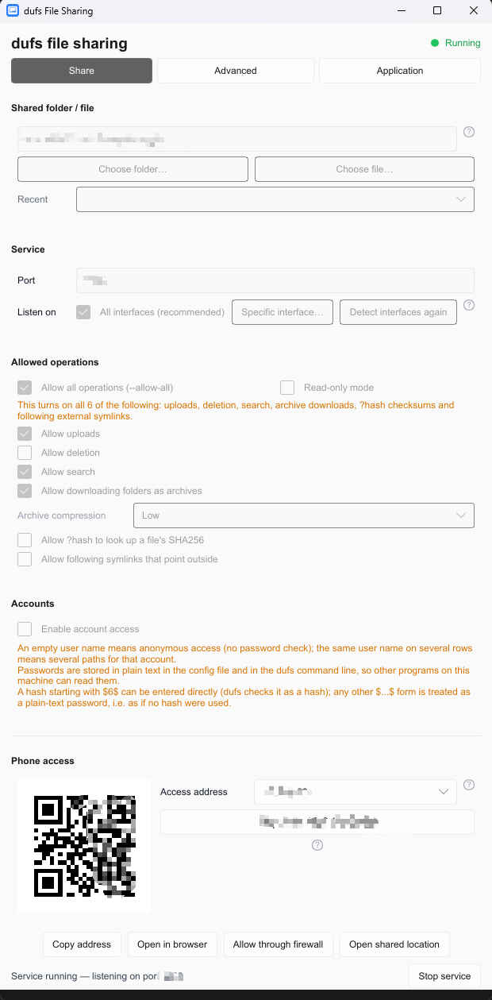
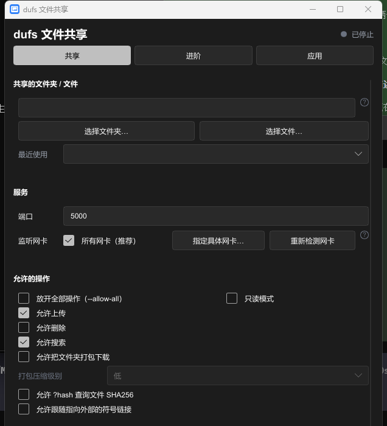
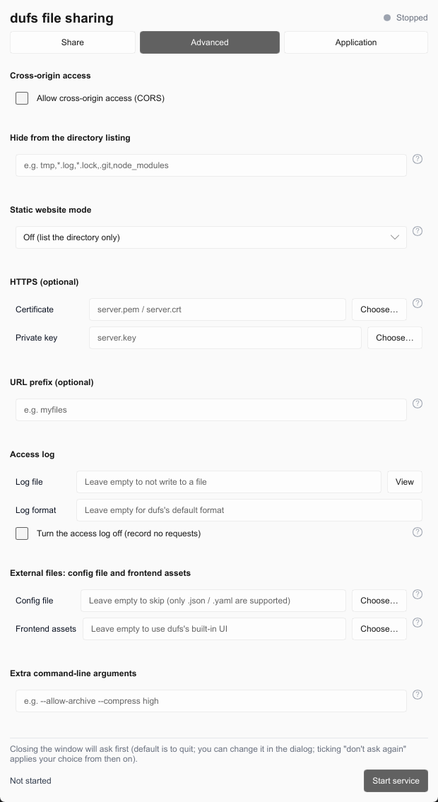
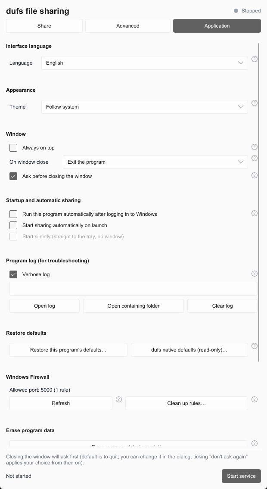

# dufs-gui

**English** · [简体中文](README.zh-CN.md)

A Windows GUI for [dufs](https://github.com/sigoden/dufs). dufs is a small file
server written in Rust, but starting it from a terminal every time is a hassle.
This project puts its command-line options behind a graphical interface, so
sharing a folder or a single file with a phone or another device on the LAN does
not require a terminal. Just double-click the exe, click start, then open the LAN
URL or scan the QR code to browse and upload files on the web page served by dufs.

> Bundles dufs's official precompiled `dufs.exe` and runs it as a subprocess.

## Features

- Single self-contained exe, no installer, no .NET or VC++ runtime required
- Share a whole folder, or just a single file
- Drag files or folders onto the window to share them
- QR code for phone access: browse, upload, search, download archives
- Every dufs command-line option is exposed in the UI, except the three that
  only make sense in a terminal (`--completions`, `-h`, `-V`)
- Configure port, listening interfaces, accounts with per-directory
  permissions, HTTPS, access log, static site mode
- Light/dark theme at runtime (follow system / light / dark)

## Screenshots

| Running, with QR code for phone access | Dark theme |
|:--:|:--:|
|  |  |

| Advanced | Application (includes Appearance / Theme) |
|:--:|:--:|
|  |  |

## Download and run

Download `dufs-gui.exe` from [Releases](https://github.com/stilltid/dufs-gui/releases)
and run it. Requires Windows 10/11 x64.

This program only touches these three locations:

- `%LOCALAPPDATA%\dufs-gui\bin\` — extracted `dufs.exe` and runtime library
- `%APPDATA%\dufs-gui\config.json` — UI settings
- `%TEMP%\dufs-gui.log` — run log, cleared on every start

Delete them to uninstall.

The program makes exactly one outbound request: the GitHub releases API, and only
when you click **Check for updates** under Application → About. Nothing is sent
at startup, and nothing is collected.

The exe is not code-signed, so SmartScreen may warn on first launch. Some
antivirus heuristics also flag it, because the binary embeds another exe.
"Run anyway" is safe here.

## Usage

1. Pick the folder or file to share.
2. Enable account access on the Share tab. Without authentication, anyone on
   the same LAN can browse and upload.
3. Click **Start service**, then scan the QR code with a phone camera, or type
   the URL into a browser to open the dufs web page.

If the phone cannot connect, confirm both devices are on the same LAN, then use
**Allow in firewall**.

## Build from source

Requires Windows x64 and a stable Rust toolchain.

```bash
git clone https://github.com/stilltid/dufs-gui.git
cd dufs-gui
cargo build --release
cargo run --release --bin icon_tool -- embed target/release/dufs-gui.exe
```

## Documentation

- [`doc/`](doc) — dufs option reference (Chinese)

## License

[GPL-3.0-only](LICENSE).

Third-party components:

- **dufs 0.47.0** — MIT or Apache-2.0, © sigoden. License texts in
  [`assets/LICENSES/`](assets/LICENSES/).
- **Slint 1.18** — used under its GPL-3.0 option.
- **vcruntime140.dll** — © Microsoft, distributed under the Visual C++
  redistributable terms.

See [`THIRD-PARTY-NOTICES.md`](THIRD-PARTY-NOTICES.md) and
[`LICENSING.md`](LICENSING.md) for details.
