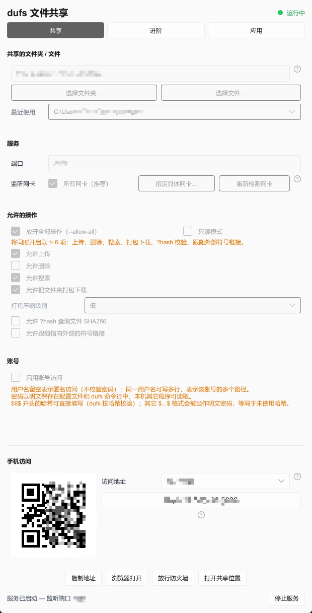
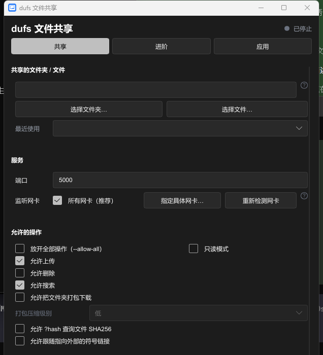
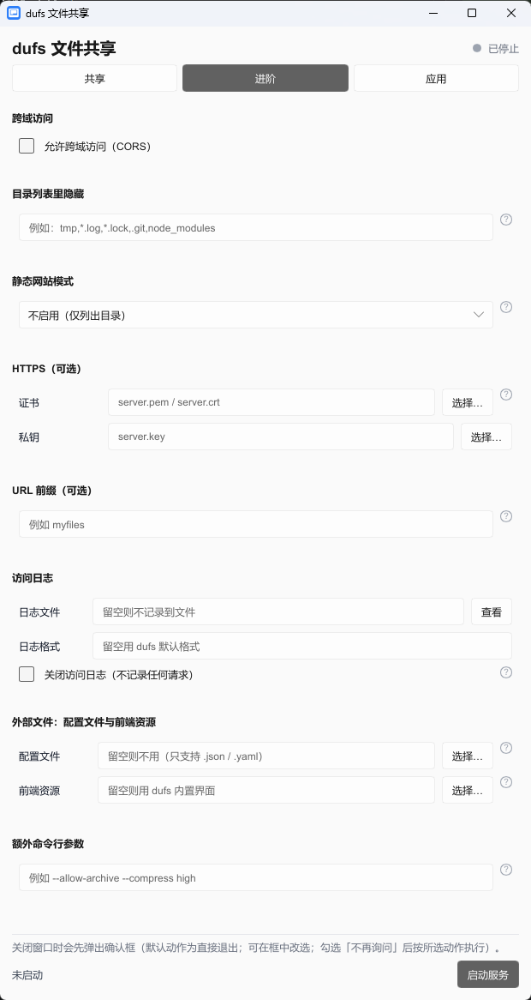
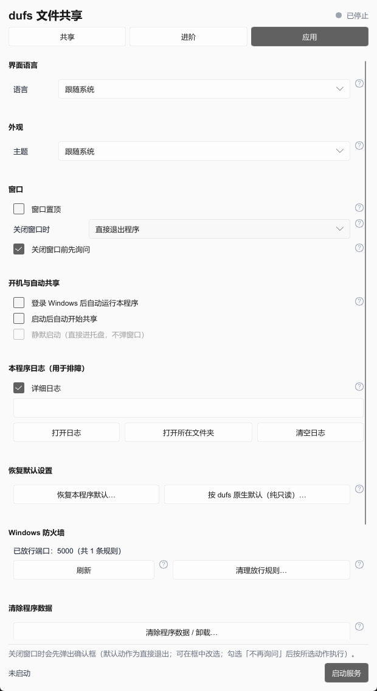

# dufs-gui

[English](README.md) · **简体中文**

Windows 上的 [dufs](https://github.com/sigoden/dufs) 图形界面。
dufs 是一个用 Rust写的轻量文件服务器；
但是每次用命令行启动还是很麻烦的。
本项目把它的命令行选项做成界面，让不熟悉终端的用户也能把文件夹或单个文件共享给手机、或局域网内的其他设备。
只需要双击exe，然后启动，然后可以通过访问局域网网址或者扫描二维码快速访问由dufs构建的网站，进行文件的下载和上传。

> 预编译的 `dufs.exe`，并以子进程调用它。

## 功能

- 单个自包含 exe，免安装，不依赖 .NET 或 VC++ 运行库
- 可共享整个文件夹，也可只共享单个文件
- 把文件或文件夹拖进窗口即可共享
- 生成二维码，手机扫码访问，支持浏览、上传、搜索、打包下载
- dufs 的命令行选项全部图形化，只保留三个终端专属项不入界面
  （`--completions`、`-h`、`-V`）
- 端口、监听网卡、账号与逐目录权限、HTTPS、访问日志、静态站点模式均可配置
- 运行期切换明暗主题（跟随系统 / 浅色 / 深色）

## 截图

|                 运行中：手机扫码访问                 |                      深色主题                      |
| :--------------------------------------------------: | :------------------------------------------------: |
|  |  |

|                        进阶                         |               应用（含「外观 / 主题」）                |
| :-------------------------------------------------: | :----------------------------------------------------: |
|  |  |

## 下载与运行

从 [Releases](https://github.com/stilltid/dufs-gui/releases) 下载 `dufs-gui.exe`，
双击运行。运行要求：Windows 10/11 x64。

本程序只会改动这三个位置：

- `%LOCALAPPDATA%\dufs-gui\bin\` —— 释放出的 `dufs.exe` 与运行库
- `%APPDATA%\dufs-gui\config.json` —— 界面设置
- `%TEMP%\dufs-gui.log` —— 运行日志，每次启动清空

删除即卸载

exe 未做代码签名，首次运行可能被 SmartScreen 拦截；因为内部嵌入了另一个 exe，
部分杀毒软件也可能启发式误报。选择「仍要运行」即可。

## 使用

1. 选择要共享的文件夹或文件。
2. 在「共享」页启用账号访问。不开启认证时，同一局域网内的任何人都能浏览和上传。
3. 点「启动服务」，用手机相机扫描二维码，或者浏览器输入网址访问dufs网页。

若手机连不上，先确认手机与电脑在同一局域网，再点「放行防火墙」。

## 从源码构建

需要 Windows x64 与 stable Rust 工具链。

```bash
git clone https://github.com/stilltid/dufs-gui.git
cd dufs-gui
cargo build --release
cargo run --release --bin icon_tool -- embed target/release/dufs-gui.exe
```

## 文档

- [`doc/`](doc) —— dufs 参数清单（中文）

## 许可证

[GPL-3.0-only](LICENSE)。

第三方组件：

- **dufs 0.46.0** —— MIT 或 Apache-2.0，© sigoden。许可正文见
  [`assets/LICENSES/`](assets/LICENSES/)。
- **Slint 1.18** —— 本项目使用其 GPL-3.0 分支。
- **vcruntime140.dll** —— © Microsoft，按 Visual C++ 可再发行组件条款分发。

详见 [`THIRD-PARTY-NOTICES.md`](THIRD-PARTY-NOTICES.md) 与
[`LICENSING.md`](LICENSING.md)。
